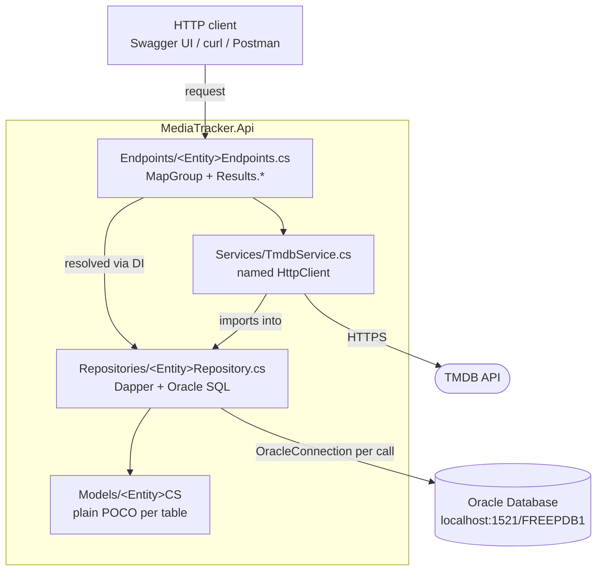
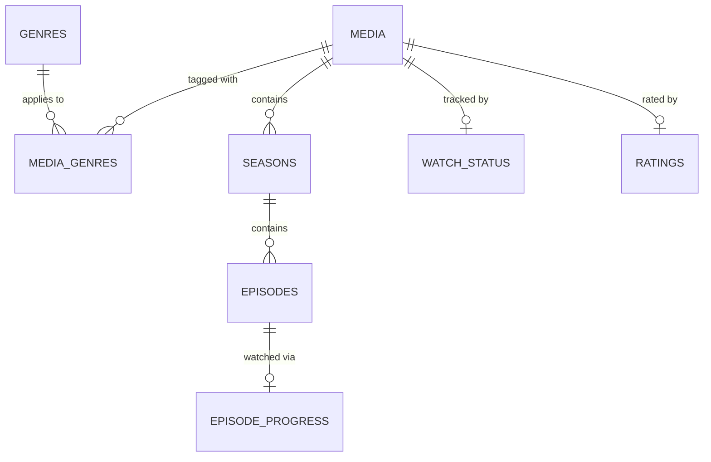
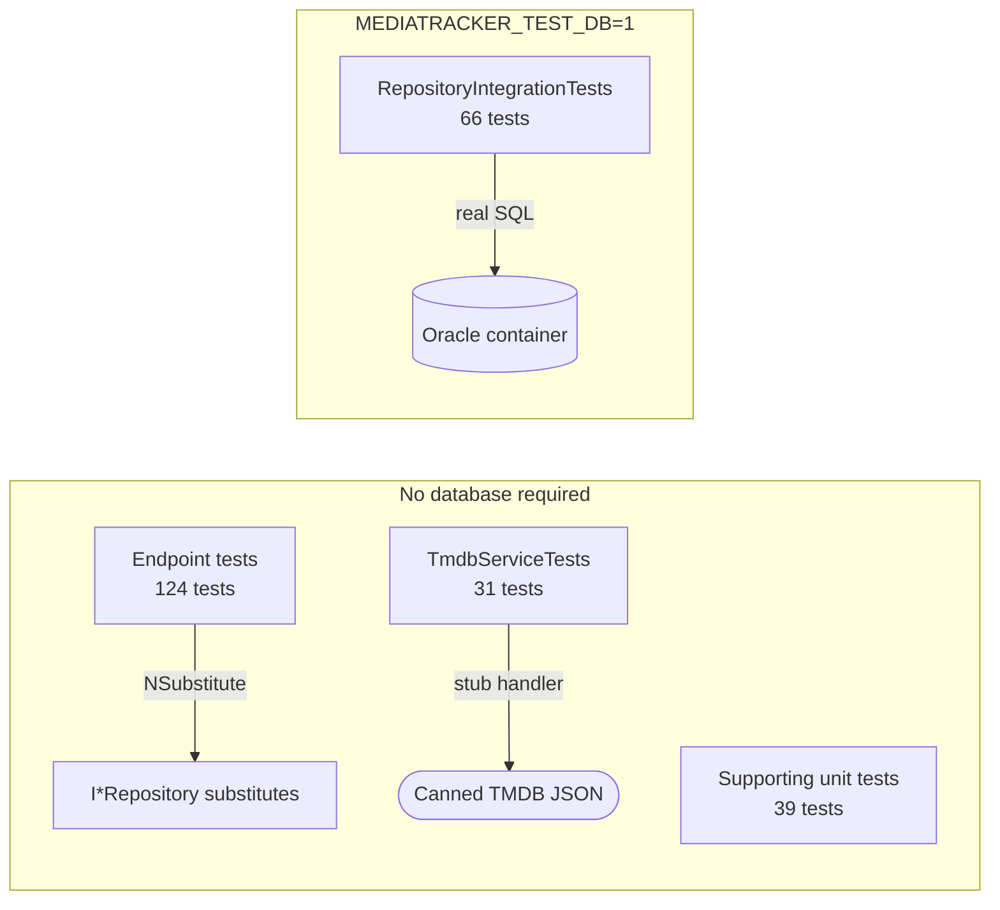

# Media Tracker

A Trakt-style tracking API for TV shows and movies. Built with **ASP.NET Core 10** minimal APIs and **Oracle Database**, with **Dapper** for data access and the **TMDB API** as an external metadata source.

[](https://dotnet.microsoft.com/)
[](https://learn.microsoft.com/aspnet/core/)
[](https://www.oracle.com/database/)
[](https://dapper-library.github.io/Dapper/)
[](https://developer.themoviedb.org/docs)
[](https://github.com/ChamuRajapaksha/media-tracker/actions/workflows/ci.yml)

Personal project, built deliberately as a portfolio piece to demonstrate C#/.NET and Oracle work end to end.

---

## Contents

- [What it does](#what-it-does)
- [Features](#features)
- [Tech stack](#tech-stack)
- [Architecture](#architecture)
- [Data model](#data-model)
- [API surface](#api-surface)
- [Oracle specifics](#oracle-specifics)
- [Getting started](#getting-started)
- [Testing](#testing)
- [What you can learn from this](#what-you-can-learn-from-this)
- [Project layout](#project-layout)
- [Roadmap](#roadmap)
---

## What it does

Track the media you want to watch, are watching, have finished, or have dropped. A single `media` row represents either a movie or a show; shows get nested seasons, which get nested episodes. Metadata can be pulled straight from TMDB and imported into the local database instead of being typed in by hand.

## Features

| Area | Capability |
| --- | --- |
| Media library | Create, browse, update and delete movies and shows; many-to-many genre tagging |
| Shows | Nested seasons and episodes, addressed as real REST resources |
| Progress tracking | Per-media watch status, upserted in a single database call |
| Episode progress | Mark individual episodes watched or unwatched; a show becomes `COMPLETED` only when every episode of every season is watched |
| Ratings | Score and review per media item, same upsert semantics |
| TMDB integration | Import a real movie or show straight from TMDB by ID, including its seasons and episodes |
| API docs | Swagger UI and an OpenAPI document, development only |
| Testing | 260 xUnit tests: endpoint logic and TMDB with no database, repository SQL against the real Oracle container |
| Secrets handling | Connection string and API key kept out of source control entirely |

## Tech stack

| Layer | Choice | Why |
| --- | --- | --- |
| Framework | .NET 10, minimal APIs | No controllers, no MVC ceremony |
| Database | Oracle Database Free (Docker, `gvenzl/oracle-free`) | Deliberate target: far less common than SQL Server or Postgres |
| Data access | Dapper 2.1 | Hand-written SQL with object mapping, chosen over EF Core for direct control and Oracle fit |
| Driver | Oracle.ManagedDataAccess.Core (ODP.NET) | Microsoft-managed Oracle driver, no Instant Client install |
| API docs | Swashbuckle.AspNetCore | Added by hand; the .NET 10 template ships no Swagger UI |
| External API | TMDB v3 | Movie and show metadata source |
| Testing | xUnit 2.9 + NSubstitute | xUnit for the runner, NSubstitute because Moq's licensing changed; `WebApplicationFactory` for the host |
| Secrets | dotnet user-secrets | Repo is public, so nothing sensitive is committed |

## Architecture

Every entity follows the same three-layer slice, with no exceptions:



- `Models/` — plain classes mirroring the tables, one per entity.
- `Repositories/I<Entity>Repository.cs` — the contract, so endpoints depend on an abstraction.
- `Repositories/<Entity>Repository.cs` — Dapper queries and Oracle SQL.
- `Endpoints/<Entity>Endpoints.cs` — a static class exposing `Map<Entity>Endpoints(this WebApplication)`, grouping routes with `MapGroup`.
- `Program.cs` — wires each repository as scoped and maps each endpoint group. Adding an entity means two lines here.

Repositories take `IConfiguration`, read `ConnectionStrings:OracleDb`, and open a fresh `OracleConnection` per method. There is no connection factory, unit of work, or ORM change-tracking layer.

## Data model



| Table | Purpose |
| --- | --- |
| `media` | One row per movie or show; `media_type` is `MOVIE` or `SHOW` |
| `genres` | Reusable genre names |
| `media_genres` | Many-to-many bridge between media and genres |
| `seasons` | Seasons belonging to a show, unique per `(media_id, season_number)` |
| `episodes` | Episodes within a season, unique per `(season_id, episode_number)` |
| `episode_progress` | Which individual episodes have been watched |
| `watch_status` | Overall status per media item: `PLAN_TO_WATCH`, `WATCHING`, `COMPLETED`, `DROPPED` |
| `ratings` | Score and review per media item |

Schema source: [`database/schema.sql`](database/schema.sql).

## API surface

| Method | Route | Purpose |
| --- | --- | --- |
| `GET` | `/media` | List all media |
| `GET` | `/media/{id}` | Get one media item |
| `POST` | `/media` | Create a media item |
| `PUT` | `/media/{id}` | Update a media item's own fields |
| `DELETE` | `/media/{id}` | Delete a media item and everything under it |
| `GET` | `/media/{id}/genres` | Genres for a media item |
| `POST` | `/media/{id}/genres/{genreId}` | Tag a media item with a genre |
| `GET` | `/media/{mediaId}/seasons` | Seasons for a show |
| `POST` | `/media/{mediaId}/seasons` | Add a season |
| `DELETE` | `/media/{mediaId}/seasons/{seasonId}` | Delete a season and its episodes |
| `GET` | `/media/{mediaId}/seasons/{seasonId}/episodes` | Episodes in a season |
| `POST` | `/media/{mediaId}/seasons/{seasonId}/episodes` | Add an episode |
| `DELETE` | `/media/{mediaId}/seasons/{seasonId}/episodes/{episodeId}` | Delete an episode |
| `GET` | `/media/{mediaId}/seasons/{seasonId}/progress` | Episodes in the season that are watched |
| `GET` | `/media/{mediaId}/seasons/{seasonId}/episodes/{episodeId}/progress` | Watch status for one episode |
| `PUT` | `/media/{mediaId}/seasons/{seasonId}/episodes/{episodeId}/progress` | Mark an episode watched; completing the season marks the show `COMPLETED` |
| `DELETE` | `/media/{mediaId}/seasons/{seasonId}/episodes/{episodeId}/progress` | Mark an episode unwatched |
| `GET` | `/media/{mediaId}/watch-status` | Current watch status |
| `PUT` | `/media/{mediaId}/watch-status` | Set watch status (upsert) |
| `GET` | `/media/{mediaId}/rating` | Current rating |
| `PUT` | `/media/{mediaId}/rating` | Set rating and review (upsert) |
| `GET` | `/genres` | List genres |
| `GET` | `/genres/{id}` | Get one genre |
| `POST` | `/genres` | Create a genre |
| `DELETE` | `/genres/{id}` | Delete a genre |
| `POST` | `/tmdb/import?tmdbId=&type=` | Import a movie or show from TMDB as a media row |
| `POST` | `/tmdb/import-seasons?mediaId=` | Import a show's seasons and episodes from TMDB |
| `GET` | `/tmdb/search?query=&type=` | Search TMDB for movies or shows |
| `GET` | `/health` | Liveness check; always `200` while the API process is up |
| `GET` | `/health/ready` | Readiness check; verifies the Oracle connection |

`type` is `movie` or `tv` on the TMDB route and is translated to the database's `MOVIE`/`SHOW` before insert. Importing the same `(type, tmdbId)` twice is idempotent: the second call refreshes the existing row and returns `200 OK` instead of creating a duplicate.

### Validation and error responses

Request bodies bind to dedicated request records, so fields such as `mediaId` and `createdAt` cannot be set by a caller. Validation runs before the endpoint delegate and returns `400` with a `ValidationProblemDetails` body.

| Endpoint | Rules |
| --- | --- |
| `POST`/`PUT` `/media` | `title` required, max 255; `mediaType` is `MOVIE` or `SHOW`; `releaseYear` 1888-2100; `overview` max 4000; `posterUrl` max 500 |
| `POST` `/genres` | `name` required, max 50 |
| `POST` `/media/{mediaId}/seasons` | `seasonNumber` >= 0; `title` max 255 |
| `POST` `/media/{mediaId}/seasons/{seasonId}/episodes` | `episodeNumber` >= 0; `title` max 255; `airDate` is an ISO date |
| `PUT` `/media/{mediaId}/watch-status` | `status` is `PLAN_TO_WATCH`, `WATCHING`, `COMPLETED`, or `DROPPED` |
| `PUT` `/media/{mediaId}/rating` | `score` 0-10 (optional); `review` max 4000 |
| `GET` `/tmdb/search` | `query` non-blank; `type` is `movie` or `tv` |
| `POST` `/tmdb/import` | `type` is `movie` or `tv` |

Nested routes verify the chain in the URL rather than trusting the ids independently. A season must belong to the media, an episode must belong to the season, and progress must belong to both; a mismatch is `404`, not an Oracle foreign-key `500`.

Oracle constraint violations are translated by a single `IExceptionHandler`: `ORA-00001` becomes `409 Conflict`, check/null/length/foreign-key violations become `400`, and anything else becomes `500`. The response is `ProblemDetails` with a correlation id that matches the server log; SQL text and Oracle messages never reach the client.

| Status | Meaning here |
| --- | --- |
| `400` | Request validation failed, or the database rejected a value |
| `404` | The media, genre, season, episode, or progress row does not exist, or is not under the parent named in the URL |
| `409` | A uniqueness rule was violated, such as linking the same genre twice |
| `500` | An unexpected database error; the correlation id in the body identifies the log entry |

Auto-complete is whole-show: marking the last unwatched episode of a show sets it to `COMPLETED`, and unmarking an episode of a `COMPLETED` show downgrades it to `WATCHING`. A show with no episodes is never auto-completed.

## Oracle specifics

The database was picked precisely because it is the awkward one, so the Oracle-flavoured parts are the interesting part of the codebase.

| Concern | Approach here |
| --- | --- |
| Bind parameters | `:Name`, not `@Name` |
| Getting the new primary key | `RETURNING <col> INTO :NewId` plus a Dapper `DynamicParameters` entry with `ParameterDirection.Output` |
| Upserts | `MERGE INTO ... USING (SELECT :p AS col FROM dual) ... WHEN MATCHED / WHEN NOT MATCHED` for `watch_status`, `ratings`, `seasons` and `episodes` |
| Column mapping | Every `SELECT` aliases snake_case columns to PascalCase (`media_id AS MediaId`) because Oracle returns uppercase column names |
| Deletes | Rely on `ON DELETE CASCADE` rather than manual child cleanup, asserted level by level by the integration suite rather than assumed |
| Timestamps | `SYSDATE`, so the column carries the database clock and not the app's |

## Getting started

Prerequisites: .NET 10 SDK, Docker Desktop, a [TMDB](https://developer.themoviedb.org/docs) API key.

### One command with Docker Compose

Docker Compose starts Oracle and the API together, creates the schema on first boot, and passes secrets through environment variables, so user-secrets are not needed for this path.

```bash
cp .env.example .env
# edit .env and set ORACLE_PASSWORD, APP_USER_PASSWORD, and TMDB_API_KEY
docker compose up --build
```

- API: `http://localhost:5165`, Swagger UI: `http://localhost:5165/swagger`
- Liveness: `http://localhost:5165/health`; readiness, which checks Oracle: `http://localhost:5165/health/ready`
- Oracle is exposed on `localhost:1521` (service `FREEPDB1`, user `media_app`) if you want to attach a SQL client.
- The first start takes a few minutes while Oracle initializes. The API waits for the database health check before it starts.
- `database/schema.sql` is applied once, on a fresh volume. The schema is not idempotent. To start over, run `docker compose down -v` and bring the stack up again.
- Compose maps `TMDB_API_KEY` to `Tmdb__ApiKey` and embeds `APP_USER_PASSWORD` in `ConnectionStrings__OracleDb`. The host-run path below still uses user-secrets.

### Run the API on the host

The steps below use a database container you manage yourself and .NET user-secrets.

**1. Start Oracle**

```bash
docker run -d --name media-tracker-db \
  -e ORACLE_PASSWORD=<oracle-password> \
  -e APP_USER=media_app -e APP_USER_PASSWORD=<app-password> \
  -p 1521:1521 gvenzl/oracle-free
```

The container does not auto-start after a reboot; use `docker start media-tracker-db` (check with `docker ps -a`). Give it a minute to report `DATABASE IS READY TO USE!` in `docker logs -f media-tracker-db`.

**2. Create the schema**

Run [`database/schema.sql`](database/schema.sql) as `media_app` in your SQL client. If you use the Oracle SQL Developer extension for VS Code, use **Run Script**, not **Run Statement** — otherwise only the first statement runs and the remaining tables are silently skipped.

**3. Store the secrets locally**

Nothing sensitive belongs in `appsettings.json`; this repo is public. `UserSecretsId` is already set in the csproj, so `dotnet user-secrets init` is not needed.

```bash
dotnet user-secrets set "ConnectionStrings:OracleDb" "User Id=media_app;Password=<app-password>;Data Source=localhost:1521/FREEPDB1"
dotnet user-secrets set "Tmdb:ApiKey" "<your-tmdb-v3-key>"
```

**4. Run it**

```bash
dotnet run --project MediaTracker.Api
```

The API listens on `http://localhost:5165`. Swagger UI is at `/swagger` in the Development environment.

**5. Try it**

Open `/swagger` and use **Execute** on any route. If you use an editor that understands `.http` files, [`MediaTracker.Api/MediaTracker.Api.http`](MediaTracker.Api/MediaTracker.Api.http) has a runnable sequence that imports a show from TMDB, pulls its seasons and episodes, marks a season watched, and deletes the result.

The README uses diagrams rather than screenshots on purpose — they stay readable as the API changes and cannot go stale.

**6. Clean up after yourself**

The `.http` samples and manual testing leave rows behind. [`database/purge-test-data.sql`](database/purge-test-data.sql) removes the smoke-test data while leaving anything you created deliberately. Run it with **Run Script**, and note it needs an explicit `COMMIT`.

## Testing

There is a real test project, [`MediaTracker.Api.Tests`](MediaTracker.Api.Tests), split by where the risk actually is rather than by what is convenient to mock.

| Layer | Approach | Count |
| --- | --- | --- |
| Endpoint orchestration | Real routing and real endpoint delegates, every repository and the TMDB service swapped for `NSubstitute` substitutes. No database, no network. | 124 |
| `TmdbService` | A stubbed `HttpMessageHandler` returns canned JSON, so URL building and deserialization are checked without touching TMDB or the network. | 31 |
| Repositories | The real Oracle container. `:param` binding, `RETURNING ... INTO`, `MERGE`, `CHECK` constraints and `ON DELETE CASCADE` cannot be honestly verified any other way. | 66 |
| Supporting units | Error mapping, the exception handler, the Oracle health check, media-type parsing, configuration loading, and the integration-test gate. | 39 |

```bash
dotnet test                    # 193 tests, integration ones reported as skipped
$env:MEDIATRACKER_TEST_DB = "1"
docker start media-tracker-db
dotnet test                    # 260 tests, integration ones execute
Remove-Item Env:\MEDIATRACKER_TEST_DB
```

**Integration tests are opt-in.** Set `MEDIATRACKER_TEST_DB=1` to run them. Without it they are reported as *skipped*, so a fresh clone shows a green suite on a machine that has never had Oracle. This is deliberate: the repository is public, and a red suite on first clone reads as broken rather than as "you need a database first".

If you opt in but have no connection string, the tests fail loudly with the `dotnet user-secrets set` command rather than passing quietly. The test project shares the API project's `UserSecretsId`, so it reads the same secrets store — no second password to configure, and nothing sensitive in the repo.

GitHub Actions runs the build and the no-database suite on every push and pull request. A second job starts an Oracle service container, applies `database/schema.sql`, and runs the repository integration tests with `MEDIATRACKER_TEST_DB=1`; coverage from the first job is uploaded as an artifact.



A few decisions worth calling out:

- **No connection factory, no production refactor.** Faking `IDbConnection` means faking `IDbCommand` and `IDataReader`, which is brittle and proves nothing about Oracle. The single production change the suite needed was `public partial class Program { }`.
- **One `EndpointApiFactory` per test, not per class.** NSubstitute keeps the `Returns` setup alive after a test ends, so a shared instance lets a later test pass on a stub an earlier one installed.
- **`SYSDATE` is the database clock.** `created_at` and `updated_at` are stamped by Oracle, not by the app, so those assertions bracket against `SELECT SYSDATE FROM dual` rather than `DateTime.UtcNow`. Comparing against the local clock fails on any machine whose timezone differs from the container's.
- **Isolation by marker.** Every integration row is tagged `ITEST-<runid>-` in its title, and teardown deletes by tracked id, with `ON DELETE CASCADE` taking the children. If a run is killed before teardown, STEP 2 of [`database/purge-test-data.sql`](database/purge-test-data.sql) cleans up by that marker prefix.

`WebApplication.CreateBuilder` only loads user-secrets when the environment is Development, so a test host with `Environment = "Testing"` would otherwise resolve a null connection string and throw in every repository constructor. `MediaApiFactory` adds the secrets source explicitly to avoid that.

## What you can learn from this

- **Minimal API architecture** — how little ceremony is needed to structure a real API around route groups, typed `Results.*` responses, and constructor injection.
- **Repository pattern with DI** — interfaces per entity, scoped lifetimes, and why the endpoints never touch SQL.
- **Dapper in anger** — parameter binding, multi-row queries, and reading generated identity values back out of Oracle without an ORM.
- **SQL the ORM would hide** — `MERGE` upserts, `RETURNING ... INTO`, identity columns, `CHECK` constraints, and `ON DELETE CASCADE` doing the referential work.
- **Oracle naming behaviour** — why unmapped snake_case columns come back uppercase and quietly break naive object mapping.
- **Third-party API integration** — typed `HttpClient` via `IHttpClientFactory`, named clients, `System.Text.Json` deserialization, and translating between two different domain vocabularies (`movie`/`tv` versus `MOVIE`/`SHOW`).
- **Debugging a real network bug** — TMDB calls hung for 100 seconds on the author's machine because `HttpClient` resolved DNS over IPv6 first. The fix in `Program.cs` overrides `ConfigurePrimaryHttpMessageHandler` to force IPv4 sockets, which is a good look at how a seemingly unrelated infrastructure quirk presents as an application-level timeout.
- **Secret management** — keeping connection strings and API keys in user-secrets so a public repository stays safe.
- **Testing without a production refactor** — deciding that the endpoint layer is worth faking but the SQL is only worth trusting, and that "skip unless opted in" is the right contract for a public repo whose tests need a database.

## Project layout

```
media-tracker/
├── database/
│   ├── schema.sql              all 8 tables, run once as media_app
│   └── purge-test-data.sql     removes smoke-test and ITEST-marked rows
├── MediaTracker.Api/
│   ├── Models/                 POCOs mirroring the tables (+ Models/Tmdb/)
│   ├── Repositories/           I<Entity>Repository.cs + <Entity>Repository.cs
│   ├── Endpoints/              one static class per entity
│   ├── Services/               ITmdbService.cs / TmdbService.cs
│   ├── Program.cs              DI registration and endpoint mapping
│   ├── MediaTracker.Api.http   runnable request samples
│   └── Properties/launchSettings.json
├── MediaTracker.Api.Tests/
│   ├── EndpointLogicTests.cs       endpoint orchestration, repositories faked
│   ├── TmdbServiceTests.cs         TmdbService against a stubbed HttpMessageHandler
│   ├── RepositoryIntegrationTests.cs  real Oracle, marker-isolated
│   ├── IntegrationFactAttribute.cs opt-in gate for anything needing the database
│   ├── MediaApiFactory.cs          WebApplicationFactory host
│   ├── TestConfiguration.cs        reads the shared user-secrets store
│   └── FakeTmdbHandler.cs          canned TMDB responses
├── MediaTracker.slnx
└── README.md
```

## Roadmap

Short version of what's next, roughly in order:

- Season and episode `PUT` endpoints, to match what media items already have
- Pagination and filtering on `/media`
